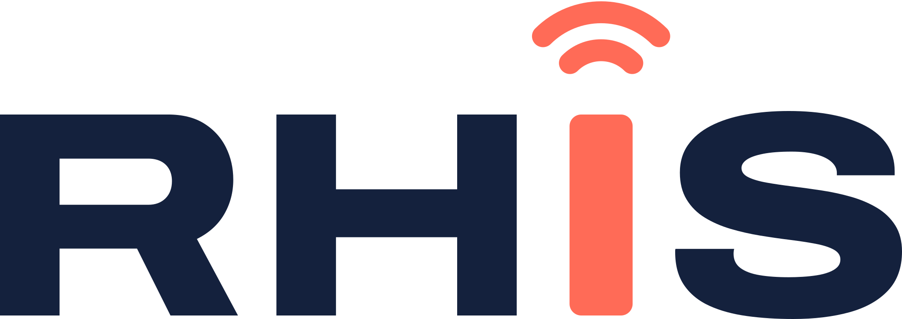

  

<h1 align="center">Captive Portal</h1>

<a href="README.md">English</a> · <b>Nederlands</b>

  Een gehost platform waarop meerdere bedrijven hun eigen captive portal voor UniFi-gastwifi bouwen en beheren. 
  Designed by <a href="https://rhis.nl">RHIS</a>.

---

## Wat is het?

Captive Portal is een multi-tenant webapplicatie. Jij (de platformbeheerder) host één server; je klanten loggen in, bouwen hun eigen gastportal in een editor, koppelen hun UniFi OS console (UDM, UDM Pro, UCG Ultra, Cloud Gateway, enz.) en laten gasten registreren, eventueel tegen betaling. Elke klant kan een eigen hostname gebruiken, zoals `gast.bedrijf.nl`, met automatisch een Let's Encrypt-certificaat.

Zie de [roadmap](ROADMAP.nl.md) voor wat er al werkt en wat eraan komt.

## Wat zit er nu in (v0.7)

- **UniFi-koppeling**: UniFi OS consoles koppelen (UDM, UCG, Dream Router, Cloud Key, zelf gehoste Network) via de UniFi Site Manager-cloud of rechtstreeks, met de officiële UniFi Network API. Gasten worden herkend aan het access point en doorgelaten met limieten voor tijd, data en snelheid.
- **Gastportal** als external portal server, ontworpen in een **drag-and-drop portal-editor** met templates, afbeeldingen, kleuren en lettertypen, in het Nederlands en Engels (de klant kiest de talen, de gast kiest er één).
- **Manieren van verbinden**: gratis met één tik, registreren met e-mail (met toestemming voor marketing), **vouchers** met printvel, **betaalde toegang** via Mollie of Stripe met pakketten en een instelbare tijd om te betalen, een **sms-code** (Twilio of MessageBird), **hotellogin** met kamernummer en achternaam (handmatig, CSV, API, Apaleo of Mews), en **Doorgaan met Facebook, Google, Apple of Microsoft**.
- **Marketing en AVG**: opt-ins voor de nieuwsbrief met export naar **Mailchimp** of **HubSpot** (automatisch of met de hand) en CSV, een bewaartermijn voor gasten zonder opt-in, en een **Privacy**-link op elke gastpagina waar gasten vragen hun gegevens te wissen (bevestigd per e-mail, ook weggehaald bij de nieuwsbriefprovider).
- **Feedback en advertenties**: een beoordeling met sterren en opmerking na het inloggen, gevolgd door een knop voor een **Google-review**, en **advertenties of een splashvideo** voor of na het inloggen met weergaven, klikken en planning.
- **Klanten factureren** vanuit het hoofdbeheerpaneel: plannen en abonnementen per klant, facturen met nummers zonder gaten, btw en je logo als pdf en per e-mail, online betalen via je eigen Mollie- of Stripe-account, herinneringen, en optioneel het gastportaal van een klant pauzeren zolang facturen onbetaald blijven. Klanten zien en betalen hun facturen in hun eigen omgeving.
- **Back-ups en herstel**: versleutelde (AES-256) volledige en incrementele back-ups van de database en datamap naar **SCP**, **FTPS**, FTP of een lokale map, met een schema per locatie en bewaartermijn, en herstellen vanaf de remote locatie in de webinterface met een veiligheidskopie en automatische rollback.
- **Volledige REST API en webhooks**: een klant-API voor alles in de omgeving van een klant en een platform-API voor klanten, gebruikers, serverinstellingen, facturatie, back-ups en updates. API-sleutels met lees/schrijfrechten, vervaldatum en rate limit, een audit trail per sleutel, ondertekende webhooks met herhaalpogingen, en OpenAPI-documentatie in het Nederlands en Engels met een verkenner om uit te proberen.
- **Notificaties en rapportages**: een e-mail zodra een hostnaam live is (A-record gevalideerd en SSL geregeld) en een maandrapportage met gasten, registraties, betalingen en piekmomenten.
- **Monitoring en live dashboard**: consoles worden elke 5 minuten gecontroleerd, met een e-mail (en webhook) als een console of access point te lang offline is en als hij weer werkt. Een live dashboard per klant toont gasten online, vandaag per uur tegenover vorige week, manieren van inloggen, gasten per access point en de laatste aanmeldingen.
- **Mail-template ontwerper**: elke e-mail, visueel of in HTML, per taal, per klant en platformbreed.
- **Eigen hostnamen met automatisch SSL**: Caddy op poort 80/443 met Let's Encrypt-certificaten op aanvraag, pas nadat het DNS-record is gecontroleerd. Ook het beheerpaneel kan een eigen HTTPS-hostnaam krijgen.
- **Klanten (tenants) en gebruikers** met drie rollen: platformbeheerder, klantbeheerder en medewerker. Uitnodigen per e-mail. De platformbeheerder beheert de klanten en de server (publiek IP-adres, hostnaam en SSL van het beheerpaneel, e-mail, SSO); consoles, portals, hostnamen en gasten horen in de eigen omgeving van elke klant.
- **Microsoft Entra ID single sign-on** (OpenID Connect met PKCE), naast of in plaats van inloggen met wachtwoord.
- **Tweestapsverificatie** met een authenticator-app (TOTP) en herstelcodes, die de platformbeheerder verplicht kan maken voor platformbeheerders en klanten, en klanten voor hun eigen team.
- **Eigen mailserver (SMTP)**: STARTTLS of TLS, minimale TLS-versie, gebruikersnaam/wachtwoord of OAuth 2.0 (Microsoft 365), DKIM-ondertekening en een testknop.
- **Info & updates**: huidige versie, controleren op updates, kiezen tussen het **stable**- en **test**-kanaal, en de **hele installatie bijwerken** (app plus Debian-pakketten) vanuit de webinterface, met automatische databaseback-up en rollback.
- **Tweetalig**: Nederlands en Engels in de interface, foutmeldingen en e-mails. Elke gebruiker kiest zijn taal; nieuwe talen voeg je toe met één vertaalbestand.
- **Moderne beheeromgeving** in de RHIS-huisstijl: menu links, licht en donker thema, werkt op telefoon.
- **Installatie** als Proxmox LXC (Debian 13) of op een Debian 13 VM of fysieke server. De webinterface draait op **poort 8080**.

## Installeren

| Waar | Commando |
| --- | --- |
| **Proxmox LXC** (op de Proxmox-host) | `bash -c "$(curl -fsSL https://raw.githubusercontent.com/rhisijmuiden/Unifi-Captive-Portal/main/ct/captive-portal.sh)"` |
| **Debian 13 VM of server** (als root) | `bash -c "$(curl -fsSL https://raw.githubusercontent.com/rhisijmuiden/Unifi-Captive-Portal/main/install/install.sh)"` |

Open daarna `http://<ip-van-de-server>:8080` en maak het eerste beheerdersaccount aan. Poort 80 en 443 gebruikt Caddy voor de gastportalen en HTTPS. Uitgebreide stappen staan in [docs/installatie.md](docs/nl/installatie.md).

## Handleidingen

- [Installatie](docs/nl/installatie.md): LXC, VM en fysieke server, eerste start, configuratiebestand
- [Een UniFi-console koppelen](docs/nl/unifi-koppelen.md): Site Manager of rechtstreeks, hotspot-instellingen, pre-authorization, problemen oplossen
- [Hostnamen en SSL](docs/nl/hostnamen-ssl.md): DNS-records, automatische certificaten, HTTPS voor het beheerpaneel
- [Portal-editor](docs/nl/portaal-editor.md): blokken, templates, afbeeldingen en talen
- [Gasttoegang](docs/nl/gasttoegang.md): manieren van inloggen, vouchers, Mollie en Stripe, tijd om te betalen, inloggen met Facebook, pre-autorisatie
- [Sms en inloggen met Google, Apple en Microsoft](docs/nl/sms-en-sociale-login.md): Twilio, MessageBird, je eigen Google-, Entra- en Apple-apps
- [Hotellogin](docs/nl/hotellogin.md): kamernummer en achternaam, CSV-import, Apaleo en Mews
- [Nieuwsbrief, AVG, feedback en advertenties](docs/nl/marketing-feedback-advertenties.md): Mailchimp, HubSpot, verwijderverzoeken, enquête, Google-review, splashvideo
- [Notificaties, monitoring, live dashboard, rapportages en e-mailtemplates](docs/nl/notificaties-mail.md)
- [Beveiliging en tweestapsverificatie](docs/nl/beveiliging.md): authenticator-app, herstelcodes, verplichte 2FA, telefoon kwijt
- [Klanten factureren](docs/nl/facturatie.md): plannen, abonnementen, facturen, online betalen, herinneringen en portalen pauzeren
- [Back-ups en herstel](docs/nl/backups.md): SCP-, FTPS- en FTP-locaties, schema, versleuteling, herstellen en calamiteitenherstel
- [API en webhooks](docs/nl/api.md): API-sleutels en scopes, klant- en platform-API, rate limits, webhooks en handtekeningen, OpenAPI
- [Updaten en releasekanalen](docs/nl/updaten.md): stable en test, updaten vanuit de interface of de terminal, rollback
- [Microsoft Entra SSO](docs/nl/entra-sso.md): app-registratie en koppeling
- [E-mail (SMTP)](docs/nl/smtp.md): Microsoft 365, Google Workspace, eigen server, DKIM
- [Ontwikkelen en releasen](docs/nl/ontwikkelen.md): lokaal draaien, projectstructuur, een release publiceren

## Techniek

| Onderdeel | Keuze |
| --- | --- |
| Backend | Node.js 24, TypeScript, Fastify 5 |
| Database | PostgreSQL (Debian 13 levert versie 17) met Drizzle ORM en migraties |
| Frontend | React 19, Vite, Tailwind CSS 4, TanStack Query |
| Inloggen | Argon2id-wachtwoorden, sessies in de database, Entra ID via OpenID Connect |
| Beveiliging | Geheimen versleuteld opgeslagen (AES-256-GCM), CSRF-bescherming, rate limiting, systemd-hardening |
| Reverse proxy en SSL | Caddy met Let's Encrypt op aanvraag per hostnaam, goedgekeurd door de app |
| UniFi | Officiële UniFi Network Integration API, via Site Manager (api.ui.com) of rechtstreeks |
| Editors | dnd-kit (slepen en neerzetten), CodeMirror 6 (HTML) |
| Betalingen | REST-API's van Mollie en Stripe met gecontroleerde webhooks |
| Facturen | PDFKit (pdf op de server gemaakt, zonder browser) |

## Licentie

© RHIS. Alle rechten voorbehouden.
